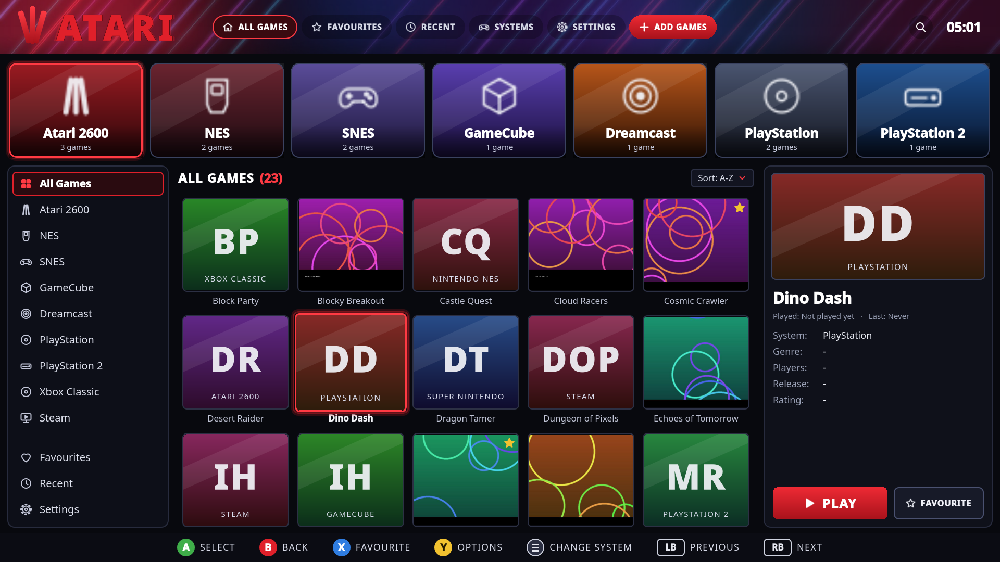
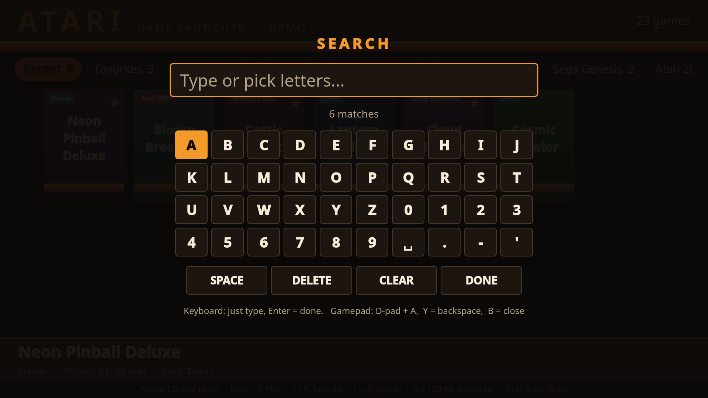
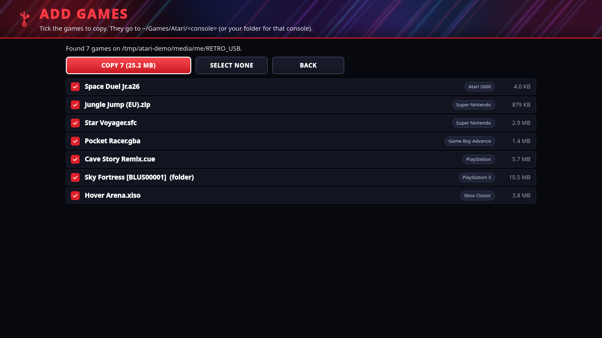
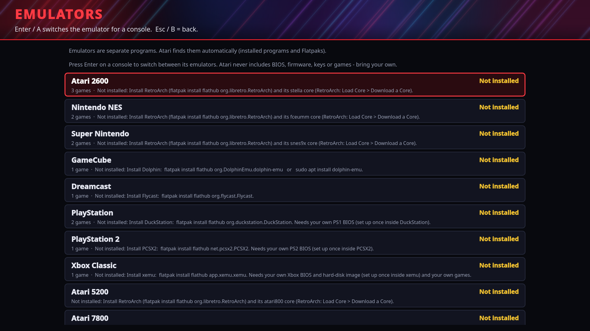
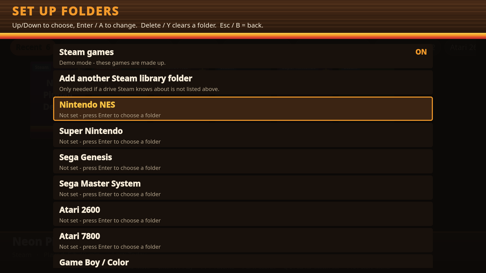

# CodeAque — a game launcher for your living-room PC



**CodeAque** is a full-screen, controller-friendly "console style" menu for a Linux gaming PC.
Pick a game from a wall of big covers, press **A** (or **Enter**), and it starts.

* **Steam** games (found automatically, even on several drives) with the artwork Steam already has on disk,
* **retro and modern console games** — Atari 2600/5200/7800/Lynx/Jaguar, NES, SNES, N64, Game Boy/GBA, Genesis, Master System,
  Saturn, Dreamcast, PlayStation 1/2/**3**/PSP, GameCube/Wii/Wii U, Switch, 3DS/DS, **Xbox Classic**, Arcade/MAME, DOS, ScummVM, Amiga,
  C64, MSX, ZX Spectrum and more — through the emulators you install,
* an **Add Games** button that copies games from a **USB stick** into your library,
* **Favourites** and **Recent** lists, **search**, sorting, and play time.

> **About the name.** "CodeAque" is just the name of this personal hobby project (it was called "Atari" up to version 0.3.x and "Code" up to 0.4.6 - the old
> `atari` and `code` commands, `~/.config/atari`, `~/.local/share/atari` and the GitHub address still work, so nothing breaks when you update).
> It is **not** affiliated with, endorsed by, or connected to any company - not Atari, not Microsoft's Visual Studio Code, not anyone else.
> Console names such as "Atari 2600" appear only as the names of systems the emulators play. There are **no company logos, character art or
> trademarked artwork** in it: the CodeAque logo (`docs/branding/`) is original artwork by the project owner (made with AI tools, 1254 px), the console tiles are original vector glyphs,
> the banner is a generated neon gradient, and covers are generated placeholders unless you provide your own.
> **No games, ROMs, emulators, BIOS files, firmware or keys are included** — you need to own the games you play
> and supply your own BIOS/firmware where an emulator needs it.

| Search with a controller | Add Games from a USB stick |
|---|---|
|  |  |
| **Emulators page** | **Setup screen** |
|  |  |

(The screenshots use made-up demo games. With no games yet you get a friendly empty screen: `docs/screenshot-empty.png`.)

## What's new in 0.5.0

* **Pair a Bluetooth controller** (Controllers page): plain steps for putting common pads into pairing mode, then **Search** (15 seconds), a list with controllers first, and one press to **pair, trust and connect** (BlueZ's `bluetoothctl`, the same as the desktop's Bluetooth settings). The administrator password is asked in CodeAque's own box only if Bluetooth is blocked or its service is stopped. Paired pads can be reconnected or forgotten.
* **Controller battery in the top bar:** a small pill per connected pad - the percentage, "Charging 40%", "Full", or "Battery unknown" for a wireless pad that does not report it (wired pads without a report are not shown). At 15% or less the pill turns red and CodeAque says once "Controller battery low". Read from `/sys/class/power_supply`, with UPower as the second source; checked every 20 seconds.
* **Screen to TV** (Settings > Screen to TV): HDMI cable steps; shows which screens are plugged in; **Same picture on both screens**, **TV only** and **This screen only** (X11 with `xrandr`; a change undoes itself after 15 seconds unless you press **Keep this**); wireless steps for Miracast (opens GNOME Network Displays when installed) and Chromecast (from Chrome / Chromium).
* **Steam games stuck on "Starting Steam... 26 s" fixed.** CodeAque no longer waits for Steam's window process before asking for the game: if Steam is running it asks straight away (`steam://rungameid/<id>`); if Steam is starting it asks after at most 12 s, and then **asks again every 8 seconds** (up to 8 times) until the game's process appears. Steam is started with `-silent` (Big Picture `-gamepadui` in CodeAque-only mode or when that setting is on). Steam is now also recognised by its process name and `~/.steam/steam.pid` (its helpers rewrite their command lines, which hid a running Steam). Every step goes to `session.log`, and the Now Playing screen has **Copy Steam log** (Y / C): CodeAque's Steam steps plus the end of Steam's own logs, copied to the clipboard and saved as `~/CodeAque-steam-log.txt`.
* **Start Steam at boot (hidden)** (Settings, on by default when Steam is installed): when CodeAque starts (CodeAque-only mode and desktop) it runs `steam -silent`, so Steam signs in with **its own** remembered login and waits in the background without taking the screen; games then open with just `steam://rungameid`. CodeAque never sees or stores a Steam password. If Steam has no remembered login, CodeAque shows "Open Steam once to log in" instead.
* **Every Steam game uses the fixed start** (Heavy Rain, Marvel Rivals, all others). For **Marvel Rivals**, if it does not start, CodeAque shows the known fix: Steam launch option `SteamDeck=1 %command%` (from ProtonDB / Steam community reports).
* **Start Steam at boot (hidden)** (Settings, on by default when Steam is installed): when CodeAque starts (CodeAque-only mode and desktop) it runs `steam -silent`, so Steam signs in with **its own** remembered login and waits in the background without taking the screen; games then open with just `steam://rungameid`. CodeAque never sees or stores a Steam password. If Steam has no remembered login, CodeAque shows "Open Steam once to log in" instead.
* **Every Steam game uses the fixed start** (Heavy Rain, Marvel Rivals, all others). For **Marvel Rivals**, if it does not start, CodeAque shows the known fix: Steam launch option `SteamDeck=1 %command%` (from ProtonDB / Steam community reports).
* **Create** (left list): **Unreal Engine** - a guided page with the official Linux download page (you sign in there with your free Epic account), finds an unpacked `UnrealEditor` (or pick it yourself) and starts it; with an honest note that it needs a strong computer (best on the new RTX laptop). Nothing is downloaded by CodeAque. **Roblox Studio** - says plainly it has no Linux version; when this computer also has Windows in its boot menu, **Reboot into Windows** (once, after you confirm). **Godot** (free, open source) - installed only when you press Install.
* **Boot screen** (Settings > Boot screen): **Install CodeAque boot screen** - a start-up menu made from CodeAque's boot art with plain gold **CodeAque** (default, starts by itself after 5 s) and **Windows**, the distro's Advanced options as a small last line for recovery, and a new splash: falling code made of our own symbols, a slow glow on the eyes, logo and ankh, a live green / gold progress bar and fade-in / fade-out; **Animated splash: OFF** gives a still picture for older graphics cards. It backs up `/etc/default/grub`, the old theme and the old splash choice first, turns on the Windows search (os-prober), runs `update-grub`, reads `grub.cfg` back, and puts everything back by itself if a step fails. **Restore old boot screen** undoes it. It never touches partitions, the disk layout or Windows. (The four-pane window shape in the art was replaced by an original ankh made of code symbols; the baked-in text and bar are live now.)
* **Find my BIOS files** (Settings, Emulators, and the missing-BIOS message): one press looks through Downloads (also inside .zip / .7z / .rar) by name, size and checksum, shows each file and where it goes, and copies on Yes (also updating `xemu.toml`). Nothing is downloaded.
* **Find my games** (Settings and Add Games): looks through Downloads, Desktop, Documents, USB drives, game folders and archives for **your own games and backups**, works out the console per file (extension, header, size, disc images, Xbox folders, multi-disc sets kept together), lists them by system with the destination, and moves or copies (your choice) into `~/Games/CodeAque/<system>`, then rescans. Unknown files and duplicates are skipped and listed. No downloads of any kind.
* **PC Games Installer:** Windows game folders are recognised and the main program is picked (setup, uninstall, redistributables and crash reporters are skipped; you can change the pick). A `setup.exe` can be run through the PC Games Installer and the installed game is then added. Each game has its own folder for Windows settings. The support files are installed only when you press Install (password in CodeAque's box). Anti-cheat warning included. (Advanced: this uses umu / Proton / Wine behind the scenes.)
* **Themes** (Settings > Theme): CodeAque Gold (default), Midnight, Neon, Light and Hoodlum Asylum (dark teal / purple with gold and a rain effect you can switch off). Applies at once and is remembered; every theme is checked for readable text and a visible controller highlight; one file per theme, and your own files in `~/.config/atari/themes/`.
* **Sim & Tycoon** (left list): your simulation and management games from Steam, PC Games, DOS and consoles (by title or genre), plus any you add or hide yourself. **Theme Hospital** is the featured game at the top, played with CorsixTH using **your own** Theme Hospital files, found automatically (GOG, EA / Origin, Heroic, ~/Games, Downloads, PC Games folders, Steam); without them it says "You need your own Theme Hospital files". Optional open-source engines, installed only when you press Install: CorsixTH (MIT), OpenRCT2 (GPL-3.0, your RCT2 files), OpenTTD (GPL-2.0, free with OpenGFX / OpenSFX / OpenMSX), Augustus (AGPL-3.0, your Caesar III files). No game data, logos or art included.
* **The project moved to github.com/hoodlumasylum/codeaque.** The updater checks the new address first and the old one as a fallback; old links redirect; the `atari` / `code` / `codeaque` commands and file names are unchanged.

## What's new in 0.4.9

* **Xbox: "Failed to open flash file ''" fixed.** *Cause:* xemu writes its own `xemu.toml` with **empty** file paths the first time it starts, and CodeAque only wrote the paths when no `xemu.toml` existed - so the paths stayed empty. Now CodeAque checks and fills in the `[sys.files]` paths (`bootrom_path`, `flashrom_path`, `eeprom_path`, `hdd_path`) after **Add BIOS files**, again **just before every Xbox game starts**, and on demand with **Settings > Emulators > Xbox: check and repair xemu settings**. A path you chose yourself that still works is never changed; the other settings in the file are left alone; a copy of the old file is kept once (`xemu.toml.codeaque-backup`). It handles the Flatpak file (`~/.var/app/app.xemu.xemu/data/xemu/xemu/xemu.toml`), the normal/AppImage one (`~/.local/share/xemu/xemu/xemu.toml`) and a portable `xemu.toml` next to the program.
* **BIOS names and sizes.** `Complex_4627.bin`, `Complex 4627`, `complex-4627-v1.03.BIN`, Cerbios, `MCPX v1.0.rom` ... are recognised (copied under the standard name), the sizes xemu needs are checked (boot ROM 512 bytes; BIOS 256 KB / 512 KB / 1 MB), and a single unnamed file of the right size next to the other Xbox files is offered as the BIOS (marked "unusual file - check it"). A missing boot ROM, BIOS or disk image is named in plain words - on the repair page and instead of xemu's own empty dialog when you press Play.
* **Create empty hard-disk image (8 GB)** button (needs `qemu-img`, `sudo apt install qemu-utils`); never replaces a file; the Xbox formats the blank disk itself. Nothing is bundled.
* **File viewer ("My files"):** every folder now shows **where you are** (breadcrumb), **Up**, and **All places**. The list of places has **Downloads, Games, Videos, each games folder (~/Games/Atari, ~/Games/Code, ~/Games/CodeAque) with its console folders, and the BIOS / emulator / CodeAque data folders** (xemu, RetroArch, DuckStation ... look-only: nothing there can be renamed or deleted). Links to folders (for example a games folder on another drive) were hidden before and now open; broken links stay hidden.
* **Controllers page** (left list under **Settings**, and **Settings > Controllers**): lists the gamepads Linux found (name, USB / Bluetooth, ids), a **Test buttons** mode that shows each button and stick you press live (the pad does not move CodeAque's menus for those 20 seconds), and **Set up pad for xemu**, which writes the pad as **player 1** (an Xbox controller) into xemu's settings (`[input.bindings] port1_driver` / `port1`, and `[input] auto_bind = true`, with the old file saved once as `xemu.toml.codeaque-backup`). The page says plainly what it could not try: there is no xemu on the build computer, so the binding is not tested with a real xemu and real pads. xemu may use a newer SDL whose pad id differs slightly; that is why xemu's own automatic binding is left on.
* **Steam games: no more stuck "loading".** A game that is **already running** is no longer asked for again (Steam ignores that, and CodeAque sat on "loading"): CodeAque brings the game's window to the front (needs `xdotool` or `wmctrl`, X11) and tracks it. While a game is running, the Now Playing screen has **Back to the game** and **Stop waiting - back to CodeAque** (Esc / B); the old "CodeAque was minimised" flag is reset on each launch; waiting for a game to start now gives up after 150 s with a plain message (Cancel is there all along).

## What's new in 0.4.8

* **Start mode: Linux desktop or CodeAque only - no commands.** *Settings > Start mode* has two clear choices, **Use Linux desktop** and **Use CodeAque only (console mode)**. It shows the current setting, read back from the computer's own files, asks for your password in the on-screen box (once), and then offers **Log out now** or **Restart the computer now** (the restart asks again, with No highlighted).
  - *Use Linux desktop* copies the three console-mode files to `/var/lib/atari-launcher/kiosk-backup/` and then removes them (the auto-login to the CodeAque session goes away). CodeAque stays installed, is put in the Mint menu and as an icon on the desktop, and your games, saves and settings are untouched.
  - *Use CodeAque only* writes the three files again (same as before).
  - If another LightDM file still auto-logs in to the CodeAque session, the result says which file.
* **Power menu > Quit to the Linux desktop** (only in console mode): asks first, then logs out into the Mint desktop for this login only, with no password. The next start is CodeAque again.
* The old *CodeAque-only mode* page is still there (details, update, repair), under the new row.
* By hand, in a Terminal (for helpers): back to the desktop - `sudo rm /etc/lightdm/lightdm.conf.d/90-atari-kiosk.conf` and restart. Console mode again from the backup - `sudo cp -p /var/lib/atari-launcher/kiosk-backup/90-atari-kiosk.conf /etc/lightdm/lightdm.conf.d/ && sudo cp -p /var/lib/atari-launcher/kiosk-backup/atari-session /usr/local/bin/ && sudo cp -p /var/lib/atari-launcher/kiosk-backup/atari.desktop /usr/share/xsessions/` and restart.

## What's new in 0.4.7

* **New name and logo: CodeAque.** The app is now called **CodeAque** everywhere you can see it (window title, menus, About page, Power menu
  "Restart CodeAque", menu entry, boot text, donate text) and has the new gold-and-emerald Anubis logo on the loading screen, the Plymouth
  boot screen, the top bar, the app icon and the new **Help > About CodeAque** page. Nothing you set up changes: the commands `code`, `atari`
  and `code-launcher` still work, there is a new `codeaque` command, settings stay in `~/.config/atari`, updates still come from the same GitHub
  address with the same `atari-<version>` files, and existing installs get the new name and command on their first start after updating.
  Games in `~/Games/CodeAque/<system>` are found too (as well as `~/Games/Atari` and `~/Games/Code`). The older version notes below still say "Code".
  The logo file is 1254 pixels wide - fine on a TV, **not print quality for metal stickers** (`docs/branding/codeaque-cutline.png` is only a
  rough outline to start from).

- **Delete game.** Every game from your games folders, every Windows game you added and every Steam game has a **DELETE GAME** button under PLAY / FAVOURITE in the game panel (D-pad: right to the panel, down to the button, A), and the **Delete** key does the same on the game list. It opens a page that asks first: the highlight starts on **No, keep it**, and the page shows the game's name, its file or folder, and its size ("4.0 KB in 1 file"). Only **Yes, delete it** deletes; Esc / B means no.
  - *Only inside your games folders.* CodeAque deletes only inside `~/Games/Atari`, `~/Games/Code`, `~/Games/CodeAque` and the folders set in Settings for a system - never the folder itself, never your home folder or a system folder (such a "games folder" is ignored), never anything a symlink or a `..` path leads outside to (a link inside a game folder is removed as a link; what it points to is left alone). The check is done again right before each file is removed. A game that lives somewhere else is not deleted and the page says so.
  - A game is its file (plus the `.bin` tracks listed in its `.cue` / `.gdi`), or for an unpacked Xbox game or a PS3 game its own folder (a folder game that sits straight in a console's folder, e.g. `xbox/default.xbe`, is refused rather than wiping the console folder). A Windows game that CodeAque unpacked is deleted with its folder and forgotten; a Windows game kept elsewhere is only removed from the library (its files stay).
  - *Saves are kept by default.* A switch on the page deletes the save files that lie next to the game with the same name (`.srm`, `.sav`, `.state1` ...); saves an emulator keeps in its own folders are never touched. Another switch deletes the game's cover picture (kept by default). Favourite / recent / play-time entries of the deleted game are forgotten.
  - *Steam games are never deleted by CodeAque.* The page says so and offers **Open Steam to uninstall it** (Steam's own uninstall window, `steam://uninstall/<id>`; Steam is started first if needed).
  - It ends with a success or error text ("Deleted Super Thing: 4.0 KB freed (1 file). Saves were kept." or what could not be removed) and the game disappears from the library. Games from Heroic / Lutris, apps and tools have no Delete button (uninstall them in their own program).

## What's new in 0.4.6

- **Quiet boot: the boot menu no longer pops up (audit of Mint / Ubuntu GRUB behaviour).** Causes found by reading Ubuntu's and Mint's GRUB scripts (not observed on the Dell - see "Not tested"):
  1. *Ubuntu's `30_os-prober` forces the menu* (`timeout_style=menu`, 10 s) whenever os-prober finds another system, and Mint turns os-prober back on in `50_linuxmint.cfg` (`GRUB_DISABLE_OS_PROBER=false`). Windows deleted, but a leftover "Windows Boot Manager" on the EFI partition or an NTFS recovery partition (Dell SupportAssist / WinRE) is enough.
  2. *`00_header` shows the menu after any boot that did not finish* ("recordfail": `set timeout=${GRUB_RECORDFAIL_TIMEOUT:-30}` and `timeout_style=menu`), e.g. after a power-button shutdown - and always on UEFI when GRUB cannot write its `grubenv`.
  3. *Code 0.4.5 left the menu visible* when another system looked present (logo and text only), and its page then still said "no boot menu". Now the page says so and offers **Hide the boot menu too**, and the "another system" note names the Windows-type partitions (with a Dell recovery hint).
  Fix: Quiet boot now also writes `/boot/grub/custom.cfg` (a marked block: `timeout_style=hidden`, `timeout=2`). `41_custom` reads it at the very end of `grub.cfg`, so it beats both rules above (Esc / Shift in the 2 s window still shows the menu; Turn off removes only Code's block and keeps anything else in that file). It also sets `GRUB_RECORDFAIL_TIMEOUT=2`, clears a stale `recordfail`, and checks that `update-grub` really rewrote `/boot/grub/grub.cfg` (a new step fails and rolls back if it did not). After turning it on, Code reads `grub.cfg`, `custom.cfg` and the rest back and shows the real result in the page ("menu hidden, 2 s window; custom.cfg last word: yes; quiet splash: yes", or what is NOT applied); the read-back also lists what could still show the menu.
- **Copy boot report.** A button on the Quiet boot page and in Settings saves `~/Downloads/code-boot-report.txt`: Code version, OS / kernel / UEFI / Secure Boot, `/etc/default/grub` and every `grub.d/*.cfg` (uncommented lines), `custom.cfg`, the boot-state keys of `grubenv`, the timeout / menu / quiet lines of `grub.cfg`, `efibootmgr -v`, `lsblk`, Plymouth, the read-back, and the boot lines of Code's session log. No passwords (lines that look like secrets are left out).
- **The Dell logo is firmware.** The logo at power-on is drawn by the computer's UEFI / BIOS before Linux or GRUB runs, so Code cannot remove it. Settings and the Quiet boot page now say so, with the hint to look in the BIOS (F2) for Fast Boot (POST Behavior > Fastboot) and any "logo" / "Full Screen Logo" option; some models have no switch.
- **Unpacking shows a percentage bar.** Extract here runs in the background (the screen stays responsive) and shows a bar with the percentage, the file being unpacked, "x MB of y MB - file 3 of 12", and a **Cancel** button (Esc / B too; Cancel removes the half-made folder). zip and tar are byte-based (written in 1 MB pieces, so even one huge file moves and Cancel reacts at once); 7z and rar read the tool's own percentage and its listed total size (or count the bytes written so far); with no total known the bar slides to and fro. The end shows a success or error message.
- **Fixed: games you put into `~/Games/Atari/xbox` (e.g. Shenmue 2) were not shown.** Cause (reproduced with a test): Code only scanned folders saved in Settings, and `~/Games/Atari/<system>` was only remembered after Code itself had copied a game there - a file dropped in by hand was invisible (this affected every console, not just Xbox; Xbox itself, xemu and its `.iso` / `.xiso` / unpacked `default.xbe` folder support were already there). Now `~/Games/Atari/<system>` (and `~/Games/Code/<system>`) is always scanned: the folder name may be the system id, its name or an alias, in any letter case (`xbox`, `Xbox`, `xbox-classic`, `Xbox Classic`, `originalxbox`, `xiso`, `ps2`, `PlayStation 2` ...), press Rescan. A folder Code does not recognise (e.g. `Xbox Games`) or a game file lying loose in `~/Games/Atari` is **flagged**: a toast on start and Rescan, the empty-library screen and Settings say which folder and which system it looks like (guessed from the name or from inside the disc image), and a **Fix** button renames the folder (or moves the file) for you - never overwriting. Xbox guide: the Emulators page now lists the files you must supply from your own Xbox (`mcpx_1.0.bin` boot ROM, BIOS `Complex_4627v1.03.bin`, `xbox_hdd.qcow2` hard-disk image, optional `eeprom.bin`) with `[found]` / `[needed]`, and where the games go. Nothing is bundled or downloaded.
- **BIOS packs: zip / 7z / rar / tar in Add BIOS files.** Add BIOS files has a new **Choose a zipped BIOS pack...** (a file chooser that also reads USB sticks), and the file viewer (**My files**) has **Use as BIOS pack** on every archive. Code unpacks it in the background into its own work folder with the same percentage bar, file name and Cancel as the file viewer (a protected pack asks for the password), finds the files each emulator needs (also Xbox: boot ROM, BIOS under its usual names, any `.qcow2` hard-disk image becomes `xbox_hdd.qcow2`, `eeprom.bin`), shows what was found and **what is still missing** per console, copies the ticked files to the right folders (xemu: its data folder and a `xemu.toml` when all three required files are there), deletes the unpacked copy and ends with "Still missing: ..." or "Nothing else is missing". Your pack is never changed; no BIOS is bundled or downloaded. A multi-GB Xbox disk image is copied as one file, so its copy step shows file count, not bytes.

## What's new in 0.4.5

- **Quiet boot / password bug fixed: Code now asks for the administrator password on its own screen.** The old button relied on pkexec (a polkit password window), which cannot appear in Code-only mode (no desktop, no authentication agent) or sits behind Code. Every privileged action (Quiet boot on/off, Update Code-only mode, installing the window manager, installing apps, power fallback) now opens Code's own password box (on-screen keyboard works with a controller; the password is shown as dots) and runs the command with `sudo -S`. The password is only sent to sudo's standard input - never put on a command line, in the environment, in config or in session.log - and is kept in memory for at most 90 s so a multi-step action asks once. A wrong password asks again with the reason (5 tries); Esc / Cancel is a clean "password window was closed - nothing changed"; a user not allowed to use sudo gets a plain message. Where no in-app dialog exists (tests, command line) nothing changes (pkexec).
- **Quiet boot really applies, and says honestly what is applied.** Writes `GRUB_TIMEOUT_STYLE=hidden`, a 2 s timeout (Shift / Esc shows the menu), `quiet splash`, `GRUB_HIDDEN_TIMEOUT_QUIET`, in `/etc/default/grub.d/zz-code-quiet.cfg` (read after Mint's `50_linuxmint.cfg`); sets `GRUB_DISABLE_OS_PROBER=true` when the only Windows entry is a leftover "Windows Boot Manager" (no Windows disk) so it is not listed again; runs update-grub, installs the Plymouth theme with the Code logo, update-initramfs, and verifies each step (a failure undoes everything and names the step; a competing grub.d file is named). The Quiet boot page now has a **read-back list** (marker, grub.cfg hides the menu, kernel line has quiet + splash, competing overrides, plymouthd.conf Theme, theme files, the boot image contains the theme, leftover Windows entry, and what THIS start-up actually used). Still fully reversible (Turn off).
- **File viewer ("My files").** A big green **OPEN THE FILE VIEWER** button at the top of Downloads, and **My files** in Options. Browses `~/Downloads`, `~/Games` and `~/Videos` only, with sizes, item counts and free disk space. For a file: **Open** (videos play full screen), **Extract here** (one button: zip, tar / tar.gz / .xz / .bz2, 7z, rar - into a new folder next to it, never overwriting; unsafe paths in an archive are refused), **Add to my games** (pick the system), **Rename** (typing box), **Delete** (asks first; the highlight starts on No). A password-protected archive asks for the password on the same in-app dialog. If 7-Zip / unrar is missing the screen shows an **Install** button. Esc / B goes up one folder.
- **Steam game launch no longer sticks on "Starting up...".** Inferred cause (not observed on the Dell): Code sent `steam://rungameid/...` right away, so when Steam was not yet running (or still starting, with no Big Picture UI yet) the request was dropped or started a second client and Code kept waiting. Now Code starts Steam first (Big Picture in Code-only mode), waits until its UI is up, then sends the launch, then waits for the game process, with live status on the NOW PLAYING screen (Starting Steam / Starting the game / Waiting for the game ...), a hint after about 60 s, a **Cancel - back to Code** button (Esc / B), a resend of the launch if nothing started, a clear message if Steam closes before the game starts, and every step written to `session.log` ("steam launch: ...").
- **Intro: the original video, with sound, filling the screen.** The shipped intro is byte-identical to the video you sent - the audio track (AAC) was never stripped. The no-sound cause: the intro was muted whenever the sound-effects switch was off. It now has its own switch (Settings > **Intro sound**, on by default), plays at volume 85 of 100, explicitly un-muted, scaled to fill the whole display (`--panscan=1.0`, no black bars), and any key or controller button skips it.
- **Support Code (optional).** A **Support Code (optional)** button in Settings and in the Options menu opens the PayPal donate page (https://paypal.me/Codeemulator) in a browser window (its own private profile; Esc twice or Guide + B returns to Code). Code is free; nothing is ever shown unless you press it - no pop-ups, no reminders. The link is one constant (`DONATE_URL` in `atarilauncher/donate.py`) so it can be changed later.

## What's new in 0.4.4

- **Steam always opens in Big Picture in Code-only mode, however it is started.** (1) The Steam tile always uses `-gamepadui` there (the "Open Steam in Big Picture" setting can no longer turn it off in Code-only mode). (2) Steam's own setting "Start Steam in Big Picture Mode" is switched on (`StartupMode = 1` in `~/.steam/registry.vdf`, written only while Steam is closed, with a backup `registry.vdf.code-backup`). (3) A `steam` wrapper is put first in Code's PATH, so a plain `steam` started by anything Code launches gets `-gamepadui` (or opens Big Picture in an already-running Steam). (4) While Code runs, a Steam client that Code did not start (an autostart entry, a desktop menu, a terminal) is told, 12 s and again 35 s after it appears, to open Big Picture (`steam://open/bigpicture`, harmless if Big Picture is already open).
- **Steam's desktop dialogs (game Properties, Settings) no longer vanish.** They were opening behind (or off the edge of) Code's full-screen window in a session without a window manager. Now: Code hides itself while Steam runs (Code-only mode), the Code-only page has **Install the window manager (openbox)** (one password; the session already starts openbox when it is installed, so windows stack and focus properly after a restart), and the Steam page and the Big Picture setting say to use Big Picture's own menus for Properties and Settings.
- **Steam Play (Proton) for all games by default** (Code-only mode): `CompatToolMapping > "0"` in Steam's `config/config.vdf` is set to `proton-experimental` when no tool was chosen yet (never overwrites your choice; per-game choices kept; Steam closed; backup `config.vdf.code-backup`). Off switch: `proton_default = false` in `[steam]` of config.toml. A button on the Steam page does it on demand.
- **BandLab tile (web music studio).** A **BandLab (music studio)** tile in the Studio area, right next to the built-in Studio. It opens bandlab.com/studio in its own browser window (own private profile, so you sign in once and it remembers you), **Esc twice** (or Guide + B) returns to Code, and the microphone is allowed for recording (Chrome / Chromium / Brave get `--use-fake-ui-for-media-stream` for this window only; Firefox gets a `user.js` pref in its BandLab profile) - choose the input device in BandLab's own audio settings. The icon is fetched at runtime (coloured initial until then); nothing of BandLab is bundled.

## What's new in 0.4.3

- **Power menu.** Options (F10 / Menu / the controller's Start button) > **Power: restart Code, restart device, shut down** (the last entry; it replaces "Quit Code" / "Restart Code", which are now inside it). **Restart Code** relaunches the app (in Code-only mode it ends Code and the session program starts it again), **Quit Code** (desktop only), **Restart device**, **Shut down** and **Sleep**. Restart and shut down ask first, and the highlight starts on **"No, go back"**, so a stray Enter / A cancels. It runs `systemctl reboot` / `systemctl poweroff` / `systemctl suspend` (normally no password for the person at the computer), and if the system refuses it asks for the password with `pkexec systemctl ...`; if that fails too, the reason and the plain command are shown. Works the same in Code-only mode.
- **Quiet boot is fixed and now always tells you what happened.** What was wrong in 0.4.2 (found by reading the code, not observed on the Dell): (1) GRUB lists **"Windows Boot Manager" even after Windows is deleted** (its old files stay on the EFI partition), and 0.4.2 treated any Windows entry as "another system is here" and left the menu showing - now it only counts when an NTFS / BitLocker partition still exists, and there is a "hide the menu anyway" button for the other cases; (2) the boot-splash theme was only chosen with `update-alternatives`, but current Plymouth reads its theme from `/etc/plymouth/plymouthd.conf`, which only `plymouth-set-default-theme` writes - Code now uses that tool (and remembers your previous theme to put it back); (3) the GRUB file was named `90-code-quiet.cfg`, so a later `grub.d` file could override it - it is now `zz-code-quiet.cfg` (the old file is removed); (4) nothing checked that it worked and a missing command inside the script was shown as "password window closed" - now Code checks `grub.cfg` really contains the hidden-menu setting and the boot image really contains the Code theme, puts everything back if not, and names the step that failed; (5) the result was only a short toast - now the first line of the page says **DONE:** or **FAILED:** with the reason, a 20-second message appears, and every step is written to `~/.local/share/atari/session.log`.
- **See what quiet boot did, in one line** (Terminal; works on 0.4.2 too):

  ```bash
  ls -l /etc/code-boot /etc/default/grub.d /usr/share/plymouth/themes/code; cat /etc/default/grub.d/*code* 2>/dev/null; grep -c 'timeout_style=hidden' /boot/grub/grub.cfg; grep -n "menuentry 'Windows" /boot/grub/grub.cfg; plymouth-set-default-theme; cat /etc/plymouth/plymouthd.conf 2>/dev/null; update-alternatives --display default.plymouth | head -6; lsblk -o NAME,FSTYPE,LABEL; tail -20 ~/.local/share/atari/session.log
  ```

  or, on 0.4.3: `cd ~/.local/share/atari-launcher && python3 -m atarilauncher.quietboot --check`.

## What's new in 0.4.2

- **Updater fix** ("The downloaded file is damaged or was changed (its checksum does not match)"): the release files were fine. When a connection ended early (Wi-Fi drop, sleep, proxy), the old download code quietly accepted the half file, and the checksum step correctly refused it. The updater now checks the length the server announced, retries dropped connections (resuming where they stopped), asks for fresh uncached bytes, tries once more from scratch with a fresh checksum list before giving up, and a real mismatch shows the expected and actual SHA256 and the file size.
- **Code-only mode: closing an app must show Code, never the Mint desktop.** (a) Code now takes the whole screen back after an app closes whenever Code-only mode is *installed* - also when this copy of Code was started from the desktop menu or an autostart entry instead of the Code-only session (before, only a copy started by the session program did). (b) The session program (now version 3) writes `~/.local/share/atari/session.log` (every start of Code, exit code and run time, and the exact reason if it ever starts the desktop), and Code adds a line when it starts (is it the Code-only session or inside Cinnamon?) and 2 s after every app closed (is the window visible / active?). (c) Settings > Code-only mode shows what is wrong (no window manager, an auto-login file pointing at the wrong session, a leftover "desktop once" note, Code running inside the desktop) and the last log lines.
- **"Update Code-only mode" is always in Settings** while Code-only mode is installed (value UPDATE NEEDED or Up to date; password once; also at the top of the Code-only page).
- **One command to put Code-only mode right** (rewrites the three files and clears a leftover "desktop once" note; asks for the sudo password):

  ```bash
  cd ~/.local/share/atari-launcher && rm -f ~/.config/atari/desktop-once && python3 -c "from atarilauncher import kiosk; print(kiosk.enable_script('$USER'))" | sudo sh
  ```

- **One command to see what is going on** (works on 0.4.1 too):

  ```bash
  echo "session=$DESKTOP_SESSION desktop=$XDG_CURRENT_DESKTOP kiosk=$ATARI_KIOSK"; ls -l /usr/local/bin/atari-session /usr/share/xsessions/atari.desktop /etc/lightdm/lightdm.conf.d/*; grep -h "version\|^RUN" /usr/local/bin/atari-session; ls ~/.config/autostart 2>/dev/null; pgrep -a "cinnamon|muffin|openbox|nemo-desktop"; tail -15 ~/.local/share/atari/session.log 2>/dev/null
  ```

- **Quiet boot - hide the Mint branding** (Settings > "Quiet boot: hide the Mint logo and menus", reversible, password once). Hides the GRUB menu (a 2 second window: hold Shift on old BIOS, tap Esc on UEFI, and the menu is there), switches kernel / systemd start-up text off, and replaces the Mint boot logo with the Code logo on black (a Plymouth theme called "code", chosen with update-alternatives; Mint's theme stays installed). It is **not** hidden when another system (Windows, macOS ...) is on the disk, GRUB still appears by itself after a failed boot, recovery mode is untouched, and if any step fails everything is put back. The login screen is skipped by Code-only mode's auto-login; it is not restyled. By hand: `sudo rm /etc/default/grub.d/90-code-quiet.cfg && sudo update-alternatives --remove default.plymouth /usr/share/plymouth/themes/code/code.plymouth && sudo update-grub && sudo update-initramfs -u`.
- **If the in-app updater cannot be trusted on your connection, one command does the same by hand** (resumes if it drops, checks the SHA256 against the release's own list, keeps your settings and games):

  ```bash
  cd ~/Downloads && curl -fL --retry 8 --retry-all-errors -C - -o atari-0.5.0.tar.gz https://github.com/hoodlumasylum/codeaque/releases/download/v0.5.0/atari-0.5.0.tar.gz && curl -fsSL https://github.com/hoodlumasylum/codeaque/releases/download/v0.5.0/SHA256SUMS.txt | grep ' atari-0.5.0.tar.gz$' | sha256sum -c - && tar xzf atari-0.5.0.tar.gz && cd atari-0.5.0 && ./install.sh --yes
  ```

## What's new in 0.4.1

- **Intro: truly full screen, original quality.** The bundled intro is now the original video file (1280x720, ~7.5 MB; it is not 1080p, so nothing is up-scaled) instead of a re-compressed copy. mpv / VLC / ffplay are started borderless, always on top and full screen, keep the whole picture (black bars if the aspect differs, never cropped), and hide the pointer; Code's own window also goes full screen for the intro and returns to window mode afterwards.
- **Code-only mode never drops to the desktop.** Root cause: the session script ended (and logged out to the login screen, where Cinnamon is the default) whenever Code itself ended after 30 seconds or more - and games / emulators were started in Code's own process group, so an app that signalled its group could take Code down with it. Now every app runs in its own session, the session script restarts Code whenever it ends (only a deliberate exit code 64 or the one-off desktop flag leave; five quick crashes in a row still fall back to the desktop so you are never locked out), "Quit Code" is "Restart Code" in this mode, and Code re-takes the whole screen when an app closes. **If Code-only mode was switched on by an older Code, open Settings > Code-only mode once and press "Update Code-only mode" (password once): the session file lives in /usr/local/bin, which a normal update cannot rewrite.**
- **Roblox fix screen** (shown after a failed start, and under Options > Fix my game > Fix Roblox, or Help): step by step with a **Run fix** button, Sober's and Code's log paths and an honest limit. It checks the Flathub store and where Sober came from, runs `flatpak update`, tests DNS / internet / the clock / the file-picker portal, and names the cause. It also handles Sober's **"Permission Update Required"**: Code shows the command in plain English first, runs exactly `flatpak override --user --filesystem=xdg-run/app/com.discordapp.Discord:create --filesystem=xdg-run/discord-ipc-0 --device=all org.vinegarhq.Sober` (your user only, Sober only), then starts Roblox again - and applies it when it installs Sober.

- **Spotify in the background, with music buttons in the top bar.** Two tiles in *Streaming & Social*: **Spotify** (Spotify's own desktop app, Flatpak `com.spotify.Client`, one-button install) and **Spotify (web player)** (your Chrome / Firefox, own profile; music needs Widevine, which Chrome has). Both **keep playing behind Code**: press **Esc twice** (or Guide + B) and Code comes back *without* closing Spotify. While anything is playing or paused, small buttons **previous / play-pause / next** and the track name appear next to the clock (mouse, touch, keyboard or controller - Right from the WiFi button). They talk to the player through MPRIS with **`playerctl`** (`sudo apt install playerctl`; "Install everything" adds it too) and also work with other MPRIS players. Needs your own Spotify account; no Spotify logos are shipped (tile icons are fetched when Code runs).

## 0.4.0

- **Web browser + Downloads (new):** the *Web Browser* tile (Streaming & Social) opens a normal browser window with an address bar and back / forward buttons, starting at a neutral search engine; Esc twice or Guide + B returns to Code. Options > Downloads lists what you saved in `~/Downloads` (with a "still downloading" marker), and a finished file gets **Add to my games**: choose its system and it moves into `~/Games/Atari/<system>` (also reachable as `~/Games/Code/<system>`). It uses Chrome / Chromium / Brave / Firefox from your PC - no embedded engine, so pause / resume and speed are the browser's own. Code does not recommend, bookmark or link any download site, and bundles no games.
- **Torrent client (new):** *Transmission* (open source) is a tile in PC Apps and installs with one button (also from Options > Downloads); `.torrent` files in Downloads open in it. No torrents, trackers or site lists are included; use it for files you own or may legally share.
- **Go Live (new):** Options > Go Live installs **OBS Studio** with one button and opens it with a ready "Code Go Live" screen-capture scene (written once, never overwrites yours); you paste your own stream key into OBS - Code never sees or stores it. *Twitch*, *TikTok LIVE* and *YouTube Live* tiles open their web dashboards in the browser window (icons are fetched when Code runs; no logos are shipped). Linux has no OBS "Game Capture" (Windows-only): the scene captures the screen; F9 is still the built-in recorder. **TikTok LIVE Studio is Windows / Mac only**, so on Linux TikTok works through OBS with the server URL + key from TikTok's web LIVE page, and TikTok only gives those to accounts that qualify.

### New name: Code
The project is now called **Code** (it was "Atari"). New logo, window title, menu entry, Settings, Help, installer and updater messages.
**Nothing breaks when you update:** the old `atari` command, `~/.config/atari`, `~/.local/share/atari`, `~/Games/Atari`, the `atari.desktop` menu / autostart entry,
Code-only mode files and the update address all keep working (from 0.5.0 the GitHub project is `hoodlumasylum/codeaque`; the old address `hoodlumasylum/atari` forwards to it), so an existing install updates in place with all
settings, favourites and games. A new `code` command is added too - **unless** that name is already taken (Visual Studio Code uses it), in which case
`atari` and `code-launcher` still start Code. Release files are still called `atari-<version>.tar.gz` so older copies can update.
- **Branding:** `docs/branding/` has the logo, a banner and a **one-colour sticker version** (SVG + 4000 px PNG, black on transparent) for metal transfer stickers.
  The logo and intro were made with AI tools - such art may not be copyrightable or trademarkable (details in `docs/branding/README.md`).

### WiFi screen
Settings > **WiFi** (or the WiFi button next to the clock on the home screen): a list of nearby networks with signal bars, *Connected* / *Saved* marks, an
on-screen keyboard for the password (controller: D-pad + A, L1 delete, R1 switch abc / ABC / 123#+=, "/" show the password; keyboard and mouse / touch work too),
*Join a hidden network...*, **Forget** (press twice) and a clear connected / "password not accepted" message. It uses NetworkManager's `nmcli` with no root password,
stores the password inside the connection (no desktop applet needed), so it **works in Code-only mode**. No WiFi adapter, WiFi switched off or no NetworkManager
each give a plain-English message (and *Turn WiFi on*). Note: `nmcli` receives the password as a command argument, visible to other programs on the same computer for a moment.


### Start-up intro
- **Your own intro video.** Put a video in **Settings > Choose intro video** (a big-button file picker that starts in Downloads, or Videos / a USB stick). Code keeps its own copy as `~/.local/share/atari/intro.mp4` (also `.webm`, `.mkv`, `.mov`; or just drop the file there yourself). It plays **full screen before the home screen**. **Any key, a mouse click or any controller button skips it.** Sound follows Settings > *Sound effects*. It plays through **mpv** (installed with Linux Mint's media apps), else **ffplay**, else **VLC**; if none is installed or playback fails, Code quietly skips the intro and starts normally. It can never keep Code waiting longer than the clip itself (plus a second or two).
- **Settings:** *Intro video (your own)* ON/OFF (ON by default as soon as a file exists), *Choose intro video*, *Remove intro video* (deletes only Code's copy), *Code's start-up video (default)* ON/OFF, and *Play the intro now* to preview.
- **A 10-second Code intro comes with the app** (`atarilauncher/assets/intro/code-intro.mp4`, the Code logo reveal with an orchestral sting; ~3.6 MB, 720p). It plays when you have no video of your own; your own video (above) replaces it. With no video player installed, a short original animation (3.6 s, wordmark over the flowing waves) plays instead. Switch it off in Settings.
- **No third-party logos are shipped.** The shipped video and the logo are original artwork supplied by the project owner (made with AI tools - see *Branding* below).
- **Code-only mode** (0.3.2) and the Esc-twice return from Netflix / Kodi / Steam keep working exactly as before; the intro is simply the first thing you see after login.
- Screenshots (`--screenshot`) and `--selftest` never play an intro.

### Roblox: "Install Roblox - application bundle (APK) required"
That is **Sober's** screen (not Code's) for when Sober could not download Roblox by itself. Researched Oct 2026 in Sober's docs and issues (#2375, #2376, #2384): it is not that Roblox dropped x86_64. Sober downloads the app through its own update service and Google Play; when that fails twice it falls back to asking for a file. Seen causes: Sober's update service was broken for about a day in July 2026 (repaired by Sober's team on their server, no new version needed), a network / DNS / provider that blocks Google Play or `sober.vinegarhq.org`, or a very old Linux.
- Code now **notices** this (from Sober's log) when you close Sober, tests the connection to Sober's server and Google Play, and - if they are reachable - runs `flatpak update org.vinegarhq.Sober` and starts Sober **once more** (it retries the download itself). If the connection is blocked it skips the useless retry.
- If it still fails you get a plain-English message (blocked network -> try DNS 1.1.1.1 or a VPN, an adult can do it in Network settings; otherwise Sober's service is probably down - try later), also under **Help > Roblox asks for an application bundle** and **Fix my game** (button *Update Sober and test the connection*).
- **Limit, said honestly:** if Sober's service is down, Code cannot fix it. Roblox publishes no Linux APK, and Code never downloads, bundles or scrapes one. Picking an APK by hand in Sober's window needs the exact version it names plus the x86_64 part from a source you trust - not recommended for kids.

## What's new in 0.3.2

- **Original Xbox games (.iso) are found.** Add Games now looks *inside* a disc image to tell the console (Xbox, GameCube, Wii, PS2, PS1, PSP, Sega CD, Saturn), so `Shenmue II (USA).iso` in any folder just works. If it still cannot tell, it asks **"Which system is this?"** with big buttons (Xbox Classic, PlayStation 2 …) instead of skipping the file, and the result screen lists every skipped file with the reason and what was in the folder (e.g. "1 .iso, 1 .txt"). **CHOOSE SYSTEM** brings the question back. Unpacked Xbox game folders (with `default.xbe`) are found too; to start one Code turns it into a disc image with the small tool `extract-xiso` (or you use a single `.iso`).
- **Steam opens full screen in Big Picture** (`steam -gamepadui`, or the `steam://open/bigpicture` link when Steam is already open). Settings > *Open Steam in Big Picture (full screen)* turns it off (default ON). Back to Code: press **Esc twice** (or hold Esc 1 s, Ctrl+Esc, or hold **Guide + B** on a controller): Code leaves Big Picture and comes back - Steam keeps running. While a Steam game is on screen the keyboard gesture is ignored (the game owns Esc); the controller chord still works.
- **Fix Steam controller / gamepad permissions** (Help, the Steam page and Fix my game): one press installs Valve's udev rules (`steam-devices`) so Steam stops saying "Missing permissions for input devices". One password window.
- **Code-only mode** (Settings): the computer starts straight into Code with no Mint desktop. It writes three small files named "atari" (LightDM auto-login drop-in, an Code session entry, a session script) after a clear confirm screen and one password window.
  **Ways back:** Settings > *Back to Mint desktop* (removes the three files) - or Settings > *Open the Mint desktop once* (no password, this login only) - or at the login screen pick the **Cinnamon** session - or if Code cannot start three times in a row the Mint desktop starts by itself - or press **Ctrl+Alt+F2**, log in and run
  `sudo rm /etc/lightdm/lightdm.conf.d/90-atari-kiosk.conf && sudo systemctl restart lightdm`.
  Optional fast-boot tips (nothing is changed for you): `systemd-analyze blame`, then disable services you do not need (cups, ModemManager, bluetooth, NetworkManager-wait-online).
  Needs LightDM (Linux Mint's default). Not tested on real hardware yet - see the release notes.

## What's new in 0.3.1

### Get back from Netflix, YouTube, Kodi … with the keyboard
Web-app tiles (Netflix, YouTube, Disney+, Prime Video, Twitch, Instagram, Facebook, TikTok) and **Kodi** open full screen. To get back to Code press:

| What | Keys |
|---|---|
| **Esc twice quickly** (within 0.6 s) | closes the app, Code comes back |
| **Hold Esc for 1 second** | same |
| **Ctrl + Esc** | same, instantly |
| **Controller: hold Guide / Home, press B** | same |

**One single Esc still does what it always did** (leave video full screen). When the app or browser closes by itself, Code is raised and focused again.
A launch screen says *"Press Esc twice (or hold Esc for 1 second) to return to Code"* for a moment before the app covers it, and the same text is in **Help**.
Turn it off in **Settings → Esc returns to Code**. How it works: a tiny watcher reads the keyboard state of the X11 session (no key grab, no root, no extra Python
package), so it works on top of any full-screen window. A Chrome extension was rejected: Chrome 137+ ignores `--load-extension`, a page never sees the Esc that
leaves video full screen, and it could not help Firefox, Kodi or the controller. *Wayland-only sessions:* the keyboard gestures need X11 (the Linux Mint default);
the controller chord works everywhere.

### One-press Install for everything
Any tile whose program is missing shows **INSTALL** (a plus icon); one press installs it with progress and a plain-English result, then offers to open it.
Flatpak in your own account first (no password); a graphical password window only for apt packages and Google Chrome's `.deb`. **Settings → Emulators → Install emulators and apps**
has *Install essentials only* (RetroArch + cores, PCSX2, Dolphin, PPSSPP, melonDS, mGBA, Flycast) and *Install everything* (progress like "Step 2 of 32 — this can take 20+ minutes",
end-of-life chatter hidden, final summary). The same code runs `atari-install-everything [--essentials]`.
* **Steam**: a Steam tile with *Install Steam* (Flatpak `com.valvesoftware.Steam`, fallback `apt install steam-installer`), opens Steam for the first sign-in, finds Flatpak library paths,
  **Rescan Steam**, and a drive helper (ext4/btrfs/xfs good; NTFS/exFAT Windows drives and USB sticks warned about). "Install a Steam game" in **Free Games** opens `steam://install/<id>`.
* **Roblox (Sober)** has no official downloadable bundle — only Flathub. Opening a downloaded `.flatpak` by hand in Linux Mint gives **"Invalid Bundle"**; press **Install** on the tile instead.
  Code checks the computer first (x86-64, kernel 5.11+, SSE4.1; Vulkan is optional and `mesa-vulkan-drivers` can be added), explains the first start (Sober downloads Roblox itself; you sign in) and **Help** has an *Invalid Bundle* answer.
* **DuckStation's Flatpak is end-of-life** — Code installs DuckStation's official AppImage from GitHub into `~/.local/share/atari/emulators`, checked against GitHub's SHA-256, and no longer uses the Flatpak.
  Every other Flatpak id in the table was checked against Flathub (`scripts/audit_flatpaks.py` repeats the check: end-of-life flag and runtime); OpenArena's old id was fixed.

### Better covers
Smarter name matching (disc numbers, roman numerals, "The …"; `Shenmue (USA) (Disc 1).cdi` and `shenmue_disc1.gdi` both find Shenmue), sources in order: libretro box art → SteamGridDB
(only if *you* paste a free key in Settings) → Wikipedia's article picture (only the game's own infobox image, with an honest User-Agent; switch off in Settings) → libretro title screen → in-game screenshot.
**Options → Pick cover for the highlighted game** shows about eight candidates (or choose a file from disk / USB). **Help → Covers not found** lists the games without one; *Settings → Download covers*
retries. "Not found" is remembered for a few days and then tried again.

### Real icons on app tiles (nothing third-party is bundled)
Streaming & Social, PC Apps and Free Games tiles show each service's own icon, **downloaded to your computer on first use** and kept in `~/.local/share/atari/icons/`: the installed app's own icon first
(Flatpak / Kodi), else the Flathub store icon, else the site's favicon / apple-touch-icon, and Steam's own art for Steam free games. Offline or nothing found: Code's own coloured tile with the app's initials. *Settings → Download covers* re-checks.

### Screen recorder
**F9** (or controller **Guide + X**, the **Record screen** tile, or *Options → Record screen*) starts/stops recording the whole screen — it keeps going while a game or Netflix is full screen — with a red **REC** badge.
MP4 files go to `~/Videos/Atari Recordings/Code-<date>_<time>.mp4`. ffmpeg with x11grab + PulseAudio/PipeWire (libx264 ultrafast, or VAAPI via `[recording] encoder = "vaapi"`); on Wayland `wf-recorder`.
**Settings**: audio (none / game sound / microphone / both), quality, 30 or 60 fps, folder. ffmpeg is part of *install everything* and has an Install button. **Recordings** (a Tools tile and menu entry) lists them and plays with mpv.

### Studio first aid
If the Studio cannot start (numpy missing, no recording program, no microphone) it now says why in plain English with a **Fix Studio** button (also *Help → Studio does not work? Fix Studio*) that installs what is missing and switches the Studio on without a restart.
`install.sh` (and so the in-app updater) retries the numpy install and prints whether Studio support worked. Everything is logged to `~/.local/share/atari/logs/studio.log`, which **Help → Copy log** includes.

### Easier "Add Games"
*Options → Add Games* is a two-step wizard with big buttons: **From a USB stick**, **From a folder on this computer**, **A Windows game (.exe or .zip)** (and BIOS files), a visible **Back** button, Esc / B to go back, mouse, keyboard and controller. The folder picker starts at *USB sticks, Downloads, Home …* and has a *Back* row. Afterwards: **"Done - 12 games added"**, and the wizard remembers the last result.

*Untested on real hardware by the author:* Wayland, Flatpak installs, `pkexec` password windows, the Guide+B / Guide+X controller chords, PipeWire audio capture and VAAPI. Everything else runs in the test-suite (Xvfb + xdotool, fake HTTP, stubbed installers).

## What's new in 0.3.0

* **Covers download themselves.** After a scan (and from **Settings → Download covers**) Code fetches box art in the background,
  never blocking the screen ("Covers 12/80" shows progress, tiles update live). ROM games use the public
  [libretro thumbnails](https://thumbnails.libretro.com) server (`Named_Boxarts`, with smart name matching: `(USA)`, `(Rev 1)`, `[!]` etc.),
  Steam games use Steam's own local art first, then Steam's public CDN. Pictures are cached in `~/.local/share/atari/covers/`;
  your own pictures are never overwritten. It copes with being offline (tries again next time), has timeouts/retries and is polite
  (one request at a time). Turn the automatic run off in **Settings → Download covers automatically**. No account or API key needed.
* **Install everything.** **Settings → Emulators → Install emulators and apps** opens a terminal and runs `scripts/install-everything.sh`
  (also `atari-install-everything`): installs Flatpak if missing (apt, asks for your password first), adds Flathub for your user,
  then installs every emulator on Flathub plus RetroArch cores, and the PC apps below. Plain-English progress, carries on when one fails,
  prints a summary, safe to run again. All Flatpak IDs were checked against Flathub.
* **Add BIOS files** (next to **Add Games**, same USB picker). It finds *your own* BIOS / firmware files on a stick or folder by name (and known
  MD5 where there is one), shows a checklist and copies them to the right place for each emulator (RetroArch native/Flatpak, DuckStation,
  PCSX2, Flycast, melonDS, mGBA, xemu, Mednafen, Ryujinx/Eden keys…). **Code never downloads or includes BIOS files, firmware, keys or games** —
  only use files from consoles you own. PS3 firmware (`PS3UPDAT.PUP`) and Switch `prod.keys` get a short how-to. **Settings → Emulators** says in
  plain English what each console still needs ("PlayStation needs a BIOS file from your own console - use Add BIOS files").
* **Keyboard works in emulators.** Code now writes sane default keyboard bindings the first time it starts **Flycast** (arrows = D-pad, Z/X/C/V = A/B/X/Y,
  Enter = Start, WASD = stick, Q/E = triggers) — only when Flycast has no keyboard mapping yet, never overwriting yours — and **steps aside while a game
  runs** (its full-screen window is minimised and restored, raised and focused when the game quits) so the emulator gets the keyboard.
  A new **Controls** screen (Options → Help & getting started → Controls, or Settings → Emulators) lists the keys for each emulator, and the main keys are shown briefly when a game starts.
* **PC Apps / Stores.** One tile with Roblox (through **Sober**, an *unofficial* community runner — it may break after Roblox updates and you sign in to your own
  Roblox account), Heroic Games Launcher, Lutris, Bottles, itch.io, Prism Launcher, Minecraft Launcher and Moonlight. Each is detected automatically
  (Flatpak or installed program), shows an install hint if missing, and its command can be overridden under `[emulators]` in the config file
  (e.g. `heroic = "flatpak run com.heroicgameslauncher.hgl"`). Games you installed in **Heroic** and **Lutris** also appear in your library
  (read from their own files, never changed) and start through those apps.
* **Update Code from inside Code** (**Settings → Update Code**, or the green badge on the top bar): checks GitHub Releases (at most once a day, silently;
  turn it off in Settings), shows the release notes, downloads the new version, **verifies its SHA256** against the release's `SHA256SUMS.txt`, installs it
  (your settings, favourites and history are never touched; the old files are put back if anything fails) and offers to restart. No terminal needed.
  *0.3.0 is the first version that has this, so install 0.3.0 by hand once (steps below); later versions can update themselves.*
* **Add a Windows game** (Options → *Add Windows game*, or Help). Pick a `.exe`, or a `.zip` / `.7z` that has one inside; give it a name and (optionally) a cover
  picture. Archives are unpacked to `~/Games/Atari/windows/<name>/` and Code finds the main `.exe` for you (a pick-list if there are several).
  The game shows up under **Windows / PC**. It starts through, in this order: **umu-launcher** (`umu-run`), a **Proton** found on your PC (GE-Proton from
  ProtonUp-Qt, else Steam's own `steamapps/common/Proton*`), then **Wine**. Each game gets its own private Wine folder in
  `~/.local/share/atari/prefixes/<name>/`. The install-everything script installs umu-launcher (official GitHub release, SHA256-checked), Wine and ProtonUp-Qt
  (`net.davidotek.pupgui2`). The first start of a game downloads Proton once (a few minutes). Override the runner with `windows = "mycommand {exe}"` under `[emulators]`.
  Works with keyboard and gamepad (the file picker, name keyboard and pick-list are all D-pad friendly). Code downloads no games.
  *Example — the free fan game **Dreams of Saturn** (a Shenmue fan game; a Unity `.exe` inside a `.zip`; it needs a gamepad):* download the `.zip` yourself from the
  author's page, then Options → Add Windows game → choose the `.zip` → it finds the `.exe` → Add this game. Plug in a controller first.
* **Made for beginners.** *Options → Help & getting started* has a five-step checklist (1 install emulators, 2 add games from USB, 3 add BIOS files, 4 download covers, 5 Steam —
  each one press), a short FAQ, **Copy log** (puts Code's recent messages and setup on the clipboard to send to a helper) and **Safe mode: reset my settings**
  (press twice; the old settings are saved next to the new ones, and your games, favourites and play time stay). *Options → Fix my game* checks the highlighted game
  (game file there? emulator installed? BIOS present? controller found?) and says in plain English what to do. Errors are written to `~/.local/share/atari/launch.log`
  and shown with a hint; the Controls screen shows whether a controller was found.
* **Console-menu polish (PSP-style).** The selected system tile gently bobs and glows, icons in the tab bar and sidebar pop when selected, screens and game lists fade in,
  and two soft neon waves drift behind the library (two pictures slid sideways by the GPU — no shaders, nothing redrawn per frame; they pause while a game runs).
  **Settings → Reduce animations: ON** turns all of that off for a slow computer.
* **Sounds.** Original, synthesised UI sounds (made by `scripts/make_sounds.py` from plain sine waves and noise — no samples, nothing from anyone else): a navigate tick,
  select, back, favourite sparkle, a launch whoosh, a soft error tone and a startup chime. Gamepad presses make the same sounds as keys. **Settings** has *Sound effects*
  (on), *Music* (a quiet ambient loop, **off** by default, silent while a game runs), *Volume* (20–100 %). Sounds are played by a small helper process using `pygame`'s mixer
  (installed with the gamepad support) or, failing that, `paplay` / `pw-play` / `aplay`; if neither exists Code is simply silent. Config: `[ui]` in `config.toml`.
* **Streaming & Social** (its own tile): **Kodi** (`tv.kodi.Kodi`) plus web-app tiles for **YouTube** (the TV layout, `youtube.com/tv`), **Netflix**, **Disney+**, **Prime Video**,
  **Twitch**, **Instagram**, **Facebook** and **TikTok**. Each opens in a full-screen "app" window of a browser found on your PC — Google Chrome, Chromium, Brave or
  ungoogled-Chromium (`--app=URL --start-fullscreen`), else Firefox (`--kiosk`) — with **its own profile folder** (`~/.local/share/atari/webapps/<name>`), so you **sign in once per
  app** and it remembers you. The install-everything script adds **Google Chrome** (Flathub `com.google.Chrome`, includes Widevine) and the optional **AntiMicroX**
  (`io.github.antimicrox.antimicrox`, lets a controller move the mouse). Honest limits: Netflix, Prime Video and Disney+ need Widevine DRM (Chrome has it; Chromium/ungoogled may not play them;
  in Firefox accept its DRM prompt) and on Linux they stream at about **720p**, no 4K/HDR. Web pages are made for a mouse or touch screen: arrow keys + Enter work in YouTube TV, elsewhere
  use a mouse, touch, or AntiMicroX. The tiles are plain text tiles (no company logos). Use another browser with `browser = "mybrowser"` under `[emulators]` (Chromium-style flags are added).
* **Free Games** (its own tile): a short, hand-checked list of free-to-play games that run on Linux, each with a **Works on Linux** badge and the evidence. Steam games
  (Counter-Strike 2, Dota 2, Team Fortress 2, Path of Exile, Warframe, Marvel Rivals, THE FINALS, Brawlhalla — all ProtonDB gold, checked 2026-10-28) open Steam's free install page
  (`steam://install/<id>`) or start the game if you have it; open-source games (SuperTuxKart, 0 A.D., Xonotic, OpenArena, Luanti, Battle for Wesnoth, Warzone 2100, OpenTTD, Armagetron Advanced —
  all Flathub IDs verified) install through Flatpak on first Play. **Fortnite and Call of Duty / Warzone do NOT work on Linux** (their anti-cheat blocks it and Epic / Activision do not
  support it); Code shows an explanation instead of a fake launcher. Apex Legends, Destiny 2, Rainbow Six Siege and PUBG were also left out for the same reason. **Minecraft (Java)**
  works through **Prism Launcher** in PC Apps and needs your own Minecraft licence (Code includes nothing from Minecraft). Free Epic / GOG games: install **Heroic** (PC Apps); games
  you claim there appear in Code automatically. (Code does not read Epic's weekly free list itself.)
* **Hoodlum Asylum Studio** (Options → *Studio*, or the **Studio** tile): a small music studio in dark, gold and green, simpler than a full DAW, made for keyboard, gamepad and touch
  (big buttons; every screen also has on-screen ◀ ▶ ENTER BACK buttons). Screenshots: `docs/screenshot-studio-home.png`, `docs/screenshot-studio-beat.png`. Three big buttons:
  1. **Make a beat** — pick a style (**Trap, Drill, R&B, Afrobeats, Boom bap, Lo-fi, House**), then change speed (BPM), key, major/minor and a Chill↔Hard **vibe** slider, or press
     **Surprise me**. Code writes drums, 808 bass, chords and a tune and shows them in a **step-sequencer grid** with a moving playhead; **Play** previews it. All sounds are
     synthesised by Code itself with numpy (sine waves, noise, filters — no samples, nothing from anybody else).
  2. **Record your voice** — pick the microphone, optional 4-click **count-in**, record over the beat (it stops by itself at the end), keep **several takes**, play them back, trim the start/end
     (or **Auto-trim silence**; the count-in and the microphone's delay are cut off automatically so your voice lines up). Optional **headphone monitor** (hear yourself; use headphones).
  3. **Mix & share** — per-track **volume, pan, mute** and a one-press **effect** (*Vocal clean*, *Reverb*, *Echo*, *Vocal clean + reverb*), a **master loudness** (Quiet/Normal/Loud, with a limiter so it never clips),
     then **Save as WAV** or **MP3** (needs `ffmpeg` or `lame`; `sudo apt install ffmpeg`). Turn on **Advanced** to get a 3-band **EQ** and a **compressor** per track.

  Projects (beat, takes, mixer settings) are saved in `~/Music/Atari Studio/<project name>/` (`project.json`, `takes/*.wav`, the exported `.wav` / `.mp3`) — plain files you can copy anywhere.
  **Needs numpy**: `install.sh` installs it (about 20 MB); `./install.sh --no-studio` skips it and the Studio then explains how to add it.
  The beat maker sits behind a tiny interface (`atarilauncher/studio/beatgen.py`: a `name` and `generate(BeatRequest) -> Pattern`, plus `register_generator()`), so a real AI music model — local or
  an API — can be plugged in later without touching the screens, mixer or exports. *What it honestly is:* the built-in generator is **rule-based** (genre templates + a random seed), not AI, and the sounds are
  simple; it makes useful sketches, not finished records. *Limits:* recording uses `parecord` / `arecord` / `ffmpeg` and was only tested with **stand-in programs, not a real microphone**; the headphone monitor
  and the latency correction (a fixed 90 ms) are approximate; there is no auto-tune, no sample import, no piano-roll editing and no real-time effects while recording. The preview plays through the same small sound helper as the menu sounds.
* Upgrading from 0.2.x is safe: config and state are kept and new settings have defaults.

## What's new in 0.2.1

* **Fixed: could not leave the first-start setup screen.** Esc / B (and Enter on the new **DONE / CONTINUE** rows or the button in the top corner)
  now take you to the main screen, even with no games yet (you get the friendly empty screen with the **Add Games** button).
  The welcome screen only appears once; you can always reopen it from **Options → Settings**.
* Keyboard focus is now grabbed reliably when the window opens, after Alt-Tab, and if anything steals it. Mouse / touch work on every row and button.

## What's new in 0.2.0

* **New look**: banner with a red CODE wordmark, tab row (All Games / Favourites / Recent / Systems / Settings), live clock, a scrollable
  row of big console tiles, sidebar, cover grid, a detail panel with a big **PLAY** button, and a controller-hint bar.
* **Add Games** (top bar, Settings, empty screen): detects USB sticks, finds games on them, lets you tick what to copy (with total size),
  copies with a progress bar, skips duplicates, and never changes the USB stick.
* **Many more consoles** from one data-driven table, including **PlayStation 3 (RPCS3)** and **Xbox Classic (xemu)**, with native *and*
  Flatpak emulator detection. A new **Settings → Emulators** page shows what is installed and how to install the rest;
  `atari-install-everything` (or `scripts/install-everything.sh`) installs them from a terminal.
* Sort (A-Z, Z-A, Recently played, Recently added), "Show all systems" option, better covers (Steam library art, your own pictures).
* Your settings, favourites and play history carry over from 0.1.0 automatically.

---

## 1. Install (Linux Mint, Ubuntu, Fedora…)

You need a Linux computer with an internet connection (for the first install only).

1. Download **`atari-0.5.0.tar.gz`** from the [Releases page](https://github.com/hoodlumasylum/codeaque/releases/latest).
2. Open a **Terminal** and type:

   ```bash
   cd ~/Downloads
   tar xzf atari-0.5.0.tar.gz
   cd atari-0.5.0
   ./install.sh
   ```

   It may ask for your password to install a few standard system libraries (it asks first, and skips this when there is no terminal).
   It copies the app to `~/.local/share/atari-launcher`, creates a private Python environment there and adds **CodeAque** to your
   application menu (under *Games*) and an `atari` command. **You can delete the downloaded folder afterwards.**

   * Want it to open by itself when you log in (like a console)? Use `./install.sh --autostart`.
   * Other options: `--yes` (no questions), `--no-gamepad` (skip the controller library).
   * **Upgrading from 0.1.0** (or any older version): just run the same steps again. Your config (`~/.config/atari/config.toml`),
  favourites and history (`~/.local/share/atari/state.json`) are left alone.

To remove it later: `~/.local/share/atari-launcher/uninstall.sh` (your settings, play history and games are kept).

## 2. Start it

* Open your application menu and click **CodeAque**, or
* in a terminal: `atari` (add `--windowed` for a normal window instead of full screen; `./run.sh --windowed` works from a source folder too).

**Controls** (Xbox/PlayStation/Switch/8BitDo pads are all recognised by SDL):

| Do this | Keyboard | Controller |
|---|---|---|
| Move around | Arrow keys | D-pad / left stick |
| Select / play | Enter | A |
| Back / close | Esc | B |
| Add/remove favourite | F | X |
| Options menu (Add Games, sort, rescan, quit…) | F10 or O | Y |
| Change system (jump between consoles) | Tab | ≡ Menu/Start |
| Previous / next system | Q / E | LB / RB |
| Search | `/` | View/Back button, or the search icon |
| Sort | S | Y → Sort |
| Full screen on/off | F11 | — |

Search has an on-screen keyboard for controllers; with a real keyboard just type.
The console tile row shows only systems that have games (plus Steam); choose **Show all systems** to see every supported console.

## 3. Add your games

### From a USB stick (easiest)
1. Plug in the stick, choose **Add Games** (top bar, or Settings, or the empty-library screen).
2. Pick the drive (press **Refresh** if it isn't listed; **Browse folder…** lets you choose any folder instead, e.g. a card on another drive).
3. CodeAque scans the drive (read-only) for games by file type and folder name, and lists them by console with sizes.
   Tick the ones you want — *Select all* is there — and choose **Copy**.
4. Files go to `~/Games/Atari/<console>/` (or the folder you configured for that console) with a progress bar; files that already
   exist are skipped, **Cancel** stops cleanly, and then the library refreshes. The USB stick is never modified, and NTFS/exFAT/FAT
   sticks and big files (multi-GB discs) are fine. PlayStation 3 game folders (`PS3_GAME`/`EBOOT.BIN`), `.iso`, `.pkg`, and Xbox `.iso`/`.xiso` are recognised.

### From folders
On the **first start** CodeAque shows a setup screen (press **Esc**, or choose **DONE / CONTINUE**, to skip it and add games later). Later: **Options → Settings** (or the Settings tab). Pick a console, press **Enter**, choose the
folder with its games and **Use this folder**. CodeAque searches sub-folders and tidies names (`Super_Game (USA) [!].sfc` → "Super Game").
Folders like `~/ROMs/snes`, `~/Games/Atari/snes` are pre-filled when they exist.

### Steam
Nothing to do if Steam is installed normally: CodeAque looks in `~/.steam`, `~/.local/share/Steam`, the Flatpak and Snap locations and reads
**all** your Steam library folders, including drives under `/media`, `/mnt` or `/run/media`. It lists fully installed games (not tools such as Proton)
and starts them with Steam itself (`steam steam://rungameid/<id>`). Steam must be installed and signed in.

> **Steam libraries on NTFS Windows drives often fail under Proton; a Linux Steam library is recommended.** (More below, and in the Settings
> page and empty screen.)

### Covers
* **Steam games:** the artwork Steam already stored locally (`~/.steam/steam/appcache/librarycache/<appid>/library_600x900.jpg`, `header.jpg`).
* **Other games:** put a PNG or JPG named like the game (without extension) in `~/.local/share/atari/covers/`, e.g. `~/.local/share/atari/covers/Super Game.png`.
  (The older `~/.config/atari/covers/<console>/` folder still works.)
* **Downloaded covers** (see *What's new in 0.3.0*) are saved under `~/.local/share/atari/covers/` too: `<console>/<game file name>.png` for ROMs and `steam/<appid>_cover.jpg` for Steam. Your own pictures always win and are never replaced.
* Otherwise CodeAque draws a coloured placeholder cover. Nothing is downloaded unless you press **Download covers** or leave the automatic option on.
* Optional details (genre, players, release, rating) can be given in `~/.local/share/atari/metadata.json`:
  `{"Super Game": {"genre": "Platformer", "players": "1-2", "release": "1993", "rating": 4.5}}`.

## 4. Emulators

CodeAque doesn't contain emulators. Each console in the table lists emulators in order of preference — a program on your PATH **or** a Flatpak —
and CodeAque uses the first one it finds. Consoles without an emulator still show, with an install hint. See **Settings → Emulators**
(press Enter on a console to cycle the emulator or see how to install it), or in a terminal:

```bash
atari-install-everything --list              # what's installed, and how to get the rest
atari-install-everything duckstation pcsx2   # install only some via Flatpak (per-user, no sudo)
atari-install-everything                     # everything: emulators, cores and PC apps (the old name atari-install-emulators still works)
```

| Console | Default emulator candidates (Flatpak ID) |
|---|---|
| Atari 2600/5200/7800/Lynx/Jaguar, NES, SNES, Genesis, Master System, Game Gear, Sega CD, Saturn, PC Engine, Neo Geo, GB/GBC/GBA, MSX, Amiga, etc. | RetroArch (`org.libretro.RetroArch`) + the right core, or a standalone emulator (e.g. mGBA, VICE) |
| N64 | RMG, mupen64plus or RetroArch (mupen64plus-next) |
| PlayStation 1 / 2 / 3 / PSP | DuckStation (official AppImage, installed per user) / PCSX2 (`net.pcsx2.PCSX2`) / RPCS3 (`net.rpcs3.RPCS3`) / PPSSPP (`org.ppsspp.PPSSPP`) |
| GameCube / Wii / Wii U | Dolphin (`org.DolphinEmu.dolphin-emu`) / Cemu (`info.cemu.Cemu`) |
| Nintendo 3DS / DS | Azahar, Lime3DS or Citra / melonDS or DeSmuME |
| Dreamcast | Flycast (`org.flycast.Flycast`) |
| Xbox Classic | xemu (`app.xemu.xemu`) |
| Arcade, DOS, ScummVM, C64, ZX Spectrum… | MAME, DOSBox, ScummVM, VICE, Fuse via native programs or Flatpak |
| Switch | Configurable command only (set your emulator's command in Settings; no firmware or keys involved in CodeAque) |
| PS Vita | Note only (Vita3K installs games inside its own window) |
| Xbox 360 | Not supported on Linux |

**PlayStation 3:** started as `rpcs3 --no-gui <EBOOT.BIN | game folder | iso>`. Install with `flatpak install flathub net.rpcs3.RPCS3`.
You must install RPCS3's **firmware** and supply your own games; PS3 emulation is heavy on integrated graphics.
**Xbox Classic:** started as `xemu -dvd_path <iso>`. You supply your own BIOS/HDD image/games in xemu's settings.
**You must supply your own BIOS, firmware, keys and games for any emulator that needs them** — **Add BIOS files** (Options menu, Settings, or Settings → Emulators)
copies them from a USB stick for you, from consoles you own. CodeAque never downloads them.

### Keyboard keys in emulators
CodeAque steps aside while a game runs. **Help & getting started → Controls** (or Settings → Emulators) shows each emulator's keys. Flycast gets default keyboard bindings the first time (only if it has none).
RetroArch, DuckStation, PPSSPP, mGBA and PCSX2 use their own built-in keyboard defaults (listed on the Controls screen; change them inside the emulator).
Dolphin, melonDS and Switch emulators need a one-time setup inside the emulator.

Override anything in `~/.config/atari/config.toml` (or via the Settings page):

```toml
[systems.gba]
roms = ["/home/me/ROMs/gba"]
emulator = "mgba"                                          # pick a specific emulator from the table
command = "mgba-qt -f {rom}"                               # or a full custom command (empty = automatic)

[systems.ps3]
command = "rpcs3 --no-gui {rom}"

[systems.myconsole]                                        # brand-new console of your own
name = "My Console"
roms = ["/home/me/ROMs/mine"]
extensions = ["cdi", "gdi", "chd"]
command = "flycast {rom}"

[emulators]                                                # emulator program overrides
rpcs3 = "flatpak run net.rpcs3.RPCS3"
```

Placeholders in `command`: `{rom}`, `{rom_dir}`, `{rom_name}`, and for RetroArch `{retroarch}`, `{core_path}`, `{core}`, `{cores_dir}`.
Also available: `[steam] extra_libraries = [...]`, `[general] fullscreen = false`. Restart CodeAque (or *Options → Rescan*) after hand-editing.

Play time, favourites and recents are in `~/.local/share/atari/state.json`. A launch log (useful if an emulator won't start) is in `~/.local/share/atari/launch.log`.

---

## 4. Dual boot: Linux next to Windows

Goal: keep Windows exactly as it is and add Linux for a console-style gaming experience. Choose at power-on which one to use.
This is safe if you go slowly, but **partitioning can destroy data if something goes wrong**, so:

1. **Back up first.** Copy photos, documents and save games to an external drive or cloud storage. Not optional.
2. **Pick a Linux.** The easiest for newcomers is **Linux Mint** (Cinnamon edition) — friendly installer, works with
   Windows already on the disk. Gaming-focused options are **Bazzite** and **Nobara** (Steam and graphics drivers ready out of the box),
   but their installers are less forgiving for *sharing a disk* with Windows: they are happiest on their **own separate drive**.
   (CodeAque's installer is written for Mint/Ubuntu/Fedora-style systems; Bazzite/Nobara are *not tested* with it.)
3. **Check for BitLocker/Device Encryption** (Windows 11 often turns it on automatically). Find your **recovery key**
   at <https://account.microsoft.com/devices/recoverykey> *before* touching partitions; Windows may ask for it afterwards.
4. **Make room.** In Windows press `Win + X` → **Disk Management** → right-click your **C:** drive → **Shrink Volume**.
   Free **at least 100–200 GB** (more if you want many games). Leave the new space **unallocated** — don't format it.
5. **Turn off Fast Startup** (it leaves Windows' drives half-asleep so Linux can only open them read-only):
   Control Panel → Power Options → *Choose what the power buttons do* → *Change settings that are currently unavailable* →
   untick **Turn on fast startup** → Save. Then do a full **Restart** (not Shut down).
6. **Secure Boot.** Mint, Ubuntu and Fedora boot with Secure Boot **on**. Bazzite/Nobara may ask you to enrol a key the first time
   (follow their install guide). If a proprietary graphics driver (NVIDIA) asks you to set a one-time password and enrol a key on
   the next reboot, follow the blue screen's steps. Only if you still can't boot should you switch Secure Boot off in the BIOS —
   and note that some Windows games' anti-cheat wants it on.
7. **Create the installer USB.** Download the ISO from the distro's website, write it to a USB stick with
   [Balena Etcher](https://etcher.balena.io/) or Rufus, restart and pick the USB in the boot menu (usually F12, F11, F10 or Esc at power-on).
8. **Install alongside Windows.** In the installer choose **"Install Linux Mint alongside Windows Boot Manager"**
   (Ubuntu says "Install Ubuntu alongside Windows Boot Manager"). Drag the slider/choose the free space you made. Finish and restart.
   You will get a menu at every boot to choose Linux or Windows.
9. **After installing**, run Software Update, install the graphics driver (Mint: *Driver Manager*), install **Steam**
   (Software Manager) and sign in, then install CodeAque (section 1).

### Using your Windows Steam drive from Linux — read this
You will be tempted to point Linux at the Steam library you already have on Windows' drive so you don't re-download games.
**Honest warning:** it mostly doesn't work well.

* Windows drives use **NTFS**. Linux can read and write it (just click the drive in the file manager to mount it — it appears under
  `/media/<you>/` and CodeAque's folder browser lists it), and CodeAque **will list** Steam games found there.
* But Windows games run on Linux through **Proton**, which needs a real Linux file system. On NTFS, Proton games often **fail to start,
  crash, or lose saves**. Steam's own support pages say Steam libraries on NTFS are unsupported. Native Linux games can have the same trouble.
* If Windows is hibernating or "fast startup" is on, Linux can only open the drive **read-only** (or refuse), and updating games from
  both systems into the same folder can corrupt the library.

**What I recommend:** keep a **separate Steam library for Linux** on a Linux file system (**ext4**, or **btrfs**):
* best: a **dedicated second drive/SSD** formatted ext4 in Linux (the *Disks* app → format; *formatting erases the drive* — double check which one!), or
* a separate partition you create during the install, or just the default Linux home folder.

Then tell Steam about it: in **Steam → Settings → Storage**, open the drive drop-down → **Add Drive** (older Steam: *Settings → Downloads →
Steam Library Folders → Add Library Folder*), pick the drive's folder, and choose it as the default for new installs. In *Disks*
→ the drive → ⚙ → **Edit Mount Options** → untick *User Session Defaults* and tick *Mount at system startup* so it's
always there. CodeAque then finds every library Steam knows about automatically. Your Windows games stay on Windows; re-download
what you want on Linux (save games sync through Steam Cloud for many titles).

Other honest caveats: some games with kernel-level anti-cheat (many competitive multiplayer titles) don't run on Linux;
check [protondb.com](https://www.protondb.com) for each game; and big Windows updates occasionally reset the boot menu — Linux's installer docs
(or `boot-repair`) can restore it.

---

## Caveats and limits (honest list)

* CodeAque was **tested headlessly only** — with fake Steam libraries, fake ROMs and a fake USB mount — **not with a real controller, real USB stick,
  or real emulators**. Emulator command lines and Flatpak IDs are written from the emulators' documentation and may need a tweak on your system
  (use the `command =` override).
* The console tiles are original glyph art, not photos of consoles (by design: no company artwork).
* Steam play-time is measured by watching for the game's process; if it can't detect the start, the game still launches but no time is recorded.
* CodeAque does not manage Steam sign-in, downloads, Proton versions, or shader caches — Steam does.
* Controller input only works while CodeAque is the focused window (so it never steals input from a game).
* Wayland/X11 are both supported by Qt, but only headless (offscreen) testing was done. Full screen on some Wayland setups may need `F11`.
* Animations are kept light (no GPU effects) for integrated graphics, but performance was not measured on real hardware.
* Windows games: umu / Proton / Wine behaviour, anti-cheat/online games, and per-game quirks were **not tested on real hardware** (a stub runner was used in tests).
  Many Windows games need extra Wine components; Bottles/Lutris are better for those (games installed in Lutris/Heroic appear in CodeAque).
* The `.rar` and `.7z` formats need the `7z` program (`sudo apt install p7zip-full`, which the install-everything script also does).
* The Studio: see its entry above — rule-based beats (no AI model yet), recording not tested on a real microphone, MP3 export needs ffmpeg or lame.
* There is **no AppImage**; the tarball + `install.sh` is the supported way.

## Testing

```bash
.venv/bin/pip install -r requirements-dev.txt
.venv/bin/pytest
```

Covers the Steam parser, ROM scanner (incl. PS3 folders), the USB import (fake mounts, duplicates, cancel), config round-trips and migration,
emulator detection and launch-command building (native + Flatpak), play-time tracking, search/favourites/sort logic, controller logic, and
the real UI started headlessly (first run incl. Esc/B/Enter to leave setup, keyboard-focus loss, mouse clicks, empty, populated, Add Games end to end, Settings/Emulators pages). Screenshots:
`QT_QPA_PLATFORM=offscreen QT_QUICK_BACKEND=software ./run.sh --demo --windowed --size 1920x1080 --screenshot docs/screenshot.png`
(`scripts/make_demo_home.py` builds a fake home with ~20 games and a fake USB stick.)

## How it is built

Python 3 + **PySide6 / Qt Quick (QML)** for the interface; plain Python modules for Steam (`steam.py`, `vdf.py`), ROMs (`roms.py`),
the emulator table (`emulators.py`), USB import (`importer.py`), settings (`config.py`), storage (`store.py`) and launching (`launcher.py`).
Controllers are read by a small helper process using SDL2 (from the `pygame` package) and turned into key presses, so the keyboard and
controller share one code path.

## Licence and supporting CodeAque

CodeAque is **free to use, with no warranty**: MIT licensed - see `LICENSE`. CodeAque's own files are the only things shipped in this repository (its own logo, intro video and sound effects); its dependencies (PySide6 / Qt, pygame / SDL2, which are LGPL) are installed from their own packages and are not copied into it, so the MIT licence fits. If you like CodeAque and want to say thanks there is an optional **Support CodeAque** button in Settings and the Options menu that opens https://paypal.me/Codeemulator - entirely optional, CodeAque never asks or nags.
